# 05. UI 설계서 (화면 설계)

NongClock(농클락, 옛 이름 팜비드) 사용자 사이트(`/`)와 관리자 사이트(`/admin/`)의 화면 구성입니다. **지금 동작하는 화면 기준**으로 적었습니다.

- 화면 캡처: `docs/ui/*.jpg` (1440px 폭, 휴대폰은 iPhone 13 크기). 데이터는 개발용 가짜 데이터라 숫자는 예시입니다
- 각 화면이 부르는 API 의 요청·응답 모양은 `docs/06_api_spec.md` 에 있습니다 (아래 "API" 칸의 번호)
- 코드 위치: 사용자 화면 `frontend/src/pages/`, 공통 부품 `frontend/src/components/`, 관리자 `frontend/src/admin/`

> **이 문서를 고치는 규칙** — 프론트 화면(입력 칸·보여 주는 값·화면 순서·문구)을 바꾸는 PR 에서는 이 문서와 캡처도 같이 고치고 맨 아래 변경 이력에 한 줄 적습니다.

---

## 0. 공통 규칙

| 항목 | 규칙 |
|---|---|
| 대상 | 농업인 (휴대폰으로 보는 경우가 많음 → 모든 화면이 휴대폰 폭에서 가로로 넘치지 않게) |
| 가격 | 원/kg, 공영도매시장 경매 단가. 따로 고르지 않으면 전국 도매시장 평균 · 상 등급 |
| 색 | 글자 진초록 `#13261a` · 우리 색 `#2b5538` · 세이지 버튼 `#d5e6cb`(글자 `#2b5538`). **상승 빨강 · 하락 파랑** (국내 시세 표기 관례). 작물 달력: 심기 청록 · 자람 연두 · 수확 호박색 · 보관 하늘색 |
| 바탕 | 들판 사진(`frontend/public/img/field.jpg`) 위에 흰 유리 카드(흰색 84%·흐림). 홈 첫 화면만 사진이 또렷하고, 나머지 화면은 사진을 흐리게 깔아 글씨가 잘 읽히게 함 |
| 글자 | 60대 이상도 읽히게: 본문 16~17px, **가장 작은 글자 15px**(11~13px → 15, 14 → 16, 15 → 17 …, 28px 이상은 그대로). 회색 글자는 진하게 `#3f4c43`(흰 바탕 명암비 약 9:1) |
| 폭·여백 | 본문 최대 폭 1600px, 창 안쪽 여백 32px(휴대폰 16px) |
| 문구 | 화면에는 숫자와 짧은 이름표만. 추천 이유도 API 값으로 만든 정해진 문장만 씀 |
| 품목 | **50품목**(`shared/items50.json`). 가격 예측·시세·작물 추천은 **세부 품종**까지, 대시보드는 품목 단위 |
| 예측 정확도 낮은 품목 | 1개월 오차 35% 이상이거나 참고용 기간이 있는 품목 → 품목 목록에 `(!)`, 화면에 "❗ 예측 정확도 낮음" (기준은 `frontend/src/mocks/accuracy.js`) |
| 데이터가 없을 때 | 백엔드가 꺼져 있어도 가짜 데이터로 화면이 돌아감. ML API 가 꺼져 있으면 맨 위에 파란 안내 줄 (캡처에서는 뺌) |

### 0-1. 화면 목록

| 주소 | 화면 | 로그인 | 코드 |
|---|---|---|---|
| `/` | 홈 (대시보드) | - | `pages/Home.jsx` |
| `/ai` | AI 가격 예측 (지역 · 최대 1년) | **필요** (로그인 전이면 로그인 화면으로) | `pages/Predict.jsx`, `components/PredictSearch.jsx` |
| `/recommend` | 작물 추천 (내 땅으로 고르기 · 작물 정보) | **필요** (로그인 전이면 로그인 화면으로) | `pages/Recommend.jsx` |
| `/market` | 시세 · 수급 | - | `pages/Market.jsx` |
| `/news` | 농업 뉴스 | - | `pages/News.jsx` |
| `/search?q=` | 통합 검색 | - | `pages/Search.jsx` |
| `/board` · `/board/:id` · `/board/write` | 게시판 목록 · 글 · 글쓰기(로그인) | 글쓰기 · 댓글 | `pages/board/` |
| `/about` | 서비스 소개 | - | `pages/About.jsx` |
| `/login` · `/signup` | 로그인 · 회원가입 | - | `pages/Login.jsx`, `pages/Signup.jsx` |
| `/mypage` | 마이페이지 | 필요 | `pages/mypage/` |
| `/admin/` | 관리자 (대시보드 · 신고 · 게시판 · 공지 · 회원 · 데이터 수집 · 모델 성능) | 관리자 | `admin/` |
| `/auctions` … | 경매 (팀 결정으로 **보류, 숨김**. `VITE_ENABLE_AUCTION=true` 로 켬) | - | `pages/Auctions.jsx` |

### 0-2. 공통 틀 (모든 사용자 화면)

`components/Layout.jsx` · 공통 모양 `frontend/src/theme.css` (사용자 사이트만 불러옴, 관리자 사이트는 그대로)

1. **헤더** (흰 유리 띠): NongClock 로고(C 링 새싹, `public/logo-nongclock.png`, 탭 아이콘 `logo-icon.png`) · 통합 검색창(자동완성, API 2-13) · 메뉴 HOME · 가격 예측 · 작물 추천 · 시세 · 뉴스 · 게시판 · (로그인하면) 🔔 알림 · "이름 · 마이페이지" · 로그아웃 / (로그인 전) **로그인** 버튼 하나
2. **회원 전용 화면**(가격 예측 · 작물 추천 · 글쓰기 · 댓글)은 로그인 전에 누르면 **로그인 화면으로 보내고, 로그인하면 원래 화면으로 돌아옴** (`/login?next=…`)
3. **휴대폰 아래 고정 바** (폭 700px 이하): 🤖 가격 예측(언제 팔까) · 🌱 작물 추천(무엇을 심을까)
   - **휴대폰 머리말** (폭 960px 이하): 로고 · 🔔 · **☰ 메뉴**. ☰ 를 누르면 검색창 · 메뉴 6개(두 줄 큰 버튼) · 내 이름·마이페이지 · 로그아웃. 다른 화면으로 가면 닫힘
   - 휴대폰 모양은 `frontend/src/mobile.css` 한 파일에 모음 (960px 머리말 · 640px 휴대폰 · 520px 작은 휴대폰)
4. **바닥글**: 데이터 출처 · 서비스 소개 · 문의
5. 신고 기능은 없음 (11-11 삭제)

---

## 1. 홈 (대시보드) `/`

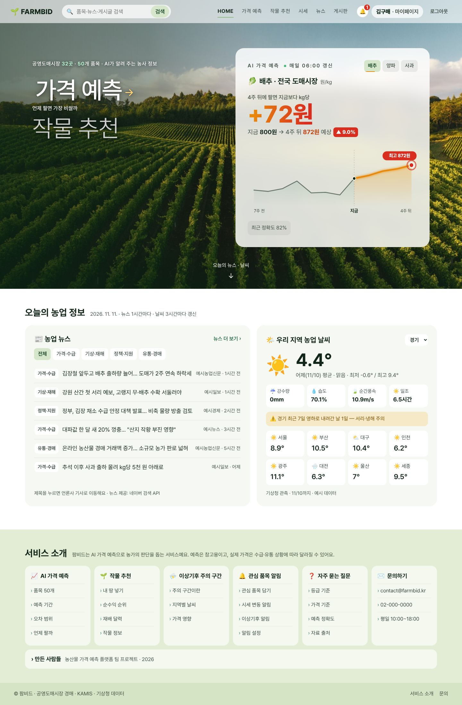

`pages/Home.jsx`, `pages/home.css`. 위에서 아래 순서:

| # | 구역 | 보여 주는 것 | 누르면 | API |
|---|---|---|---|---|
| 1 | **첫 화면** (사진 또렷, 창 높이) | 왼쪽 위 "공영도매시장 32곳 · 50개 품목 · AI가 알려 주는 농사 정보" · 큰 메뉴 **가격 예측 →** / **작물 추천** (마우스를 올리면 오른쪽 미리보기가 바뀜) · 아래 "오늘의 농업 정보 ↓" | 각 화면 | |
| 2 | 미리보기 ① AI 가격 예측 | 배추 · 양파 · 사과를 **5초마다** 바꿔 보여 줌 · "4주 뒤에 팔면 지금보다 kg당 **+n원**"(숫자가 올라가며 나타남) · 지금 → 가장 비싼 주 예상가 · 지난 7주(실제)와 앞으로 4주(예측) 그래프 · 예측 정확도 | 가격 예측 | 1-4 |
| 3 | 미리보기 ② 작물 추천 | 내 지역(로그인 전 경기) · 노지/시설/논/과수원 칩 · 순수익 1~3위 막대 | 작물 추천 | 1-6 |
| 4 | **오늘의 농업 정보** (흰 바탕) | 스크롤하면 첫 화면은 그 자리에 있고 흰 바탕이 아래에서 올라와 덮음(농넷 방식). **농업 뉴스**(분류 탭) 와 **우리 지역 농업 날씨**를 같은 높이로 나란히. 날씨는 서버 날씨 수집기의 시·도 일별 관측(`/data/weather/regions-daily.json`, 11-11 연결): 시·도 고르기(기본 내 지역) · **어제** 평균기온·최저/최고·하늘(강수·일조로 정함) · 강수량·습도·순간풍속·일조 · 최근 7일 주의 신호(영하·폭염·큰비·강풍·가뭄) 또는 평년 대비 한 줄 · 다른 8개 시·도. 서버 연결이 없으면 예시 데이터("예시 데이터" 표시), 파일이 없으면 "날씨 자료를 아직 받지 못했어요" | 언론사 기사 / 날씨 수집기 | 2-14 |
| 5 | **서비스 소개** (연한 초록 바탕) | 6칸(AI 가격 예측 · 작물 추천 · 이상기후 · 관심 품목 알림 · 자주 묻는 질문 · 문의) + 만든 사람들 | 서비스 소개 각 칸 | |

- 컴퓨터의 "동작 줄이기" 설정이면 움직임을 모두 멈춤
- 휴대폰: 첫 화면 메뉴 아래에 미리보기 두 장(AI 가격 예측 · 작물 추천)을 위아래로 모두 보여 줌(카드가 잘리지 않게 높이는 내용만큼), 뉴스·날씨는 위아래로, 지역 날씨는 4칸, 서비스 소개는 한 줄에 하나

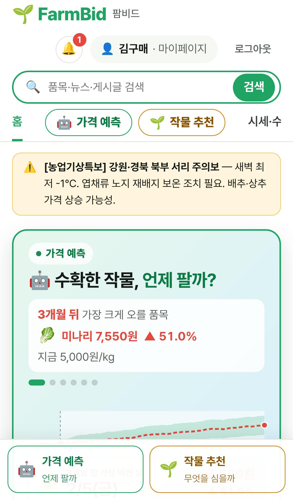

---

## 2. AI 가격 예측 `/ai`

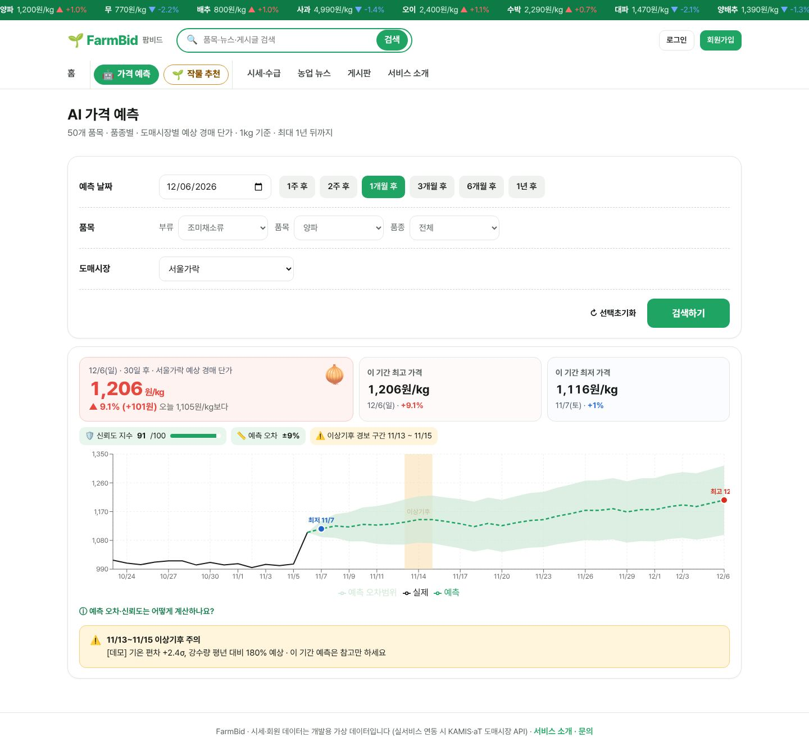

제목 "언제, 어디에 팔면 가장 비쌀까" · `pages/Predict.jsx`, `pages/predict.css` (11-11: 도매시장 → **지역**, 최대 **1년**)

### 2-1. 검색 조건 (`components/PredictSearch.jsx`)

한 줄: **1. 지역 → 2. 부류 → 3. 품목 → 4. 품종 → 5. 예측 날짜 · [예측하기 →]** · 예측 날짜 칸 바로 아래 같은 폭으로 **1주 · 1개월 · 6개월 · 1년** 버튼(오늘부터, 누르면 바로 예측)

| 입력 | 규칙 |
|---|---|
| 지역 | 맨 위 **전국 (평균)** + 공영도매시장이 있는 시·도 15곳, "서울 (2곳)" 처럼 그 품목을 거래하는 시장 수. 세종·제주는 시장이 없어 빠짐. 기본 서울. 지역 안 어느 시장에서도 거래하지 않는 품목은 목록에서 빠짐 |
| 부류 · 품목 · 품종 | 50품목(`shared/items50.json`). 품종은 "전체" + 팀 기준 품종(11-11): 화면묶음 이름이 품목 이름과 같으면 예측단위마다, 그 밖은 화면묶음째 — 예: 양파 = 저장 · 만생 · 조생 · 중생 · 자주 · 중만생 · 기타. 품종이 "기타" 하나뿐인 품목은 "전체"만. 정확도 낮은 품목은 `(!)` |
| 예측 날짜 | **내일 ~ 1년 뒤**, 기본 1개월 뒤. 지난 날짜 기준 예측은 없음(11-11 뺌) |

- 조건은 주소에 담김: `/ai?item=onion&variety=onion-7&region=경기&to=2027-11-11`. 옛 주소의 `market=시장코드` 는 그 시장의 시·도로, `date`(지난 기준일)는 무시

### 2-2. 결과

| 구역 | 보여 주는 것 |
|---|---|
| 큰 가격 | "품목 · 서울 도매시장 2곳 · 오늘부터 n주/n개월 뒤(날짜)까지" · **가장 비싼 시장·때의 예상가** · 그 시장 지금보다 ▲/▼ % · 정확도 낮은 품목은 "❗ 예측 정확도가 낮은 품목이에요" |
| 그래프 (주 단위) | 컴퓨터 화면에서는 카드가 오른쪽 열 높이만큼 늘어나고 그래프가 남는 높이를 채움(아래 빈 공간 없음). **지역 안 도매시장마다 색깔 선 하나** (예: 서울 = 서울가락 · 서울강서, 경기 = 수원 · 안양 · 안산 · 구리). 옅은 선 = 지난 8주 실제, 굵은 선 = 예측, 시장마다 가장 비싼 때에 점. x 축은 날짜 비례(지금 · n주/n개월 뒤 이름표). 시장이 하나일 때만 예측 범위 띠. 작년 같은 시기 선은 없음(11-11 뺌) |
| 시장 비교 | 시장이 둘 이상이면 "서울가락 지금 832원 → 최고 930원 (4주 뒤)" 칸을 시장마다, 가장 비싼 시장 강조 |
| 출하 추천 | "출하 추천: 시장 · n월 n주차 (날짜 무렵)" + 지금보다 kg당 더 받는 금액. 지금보다 비싼 때가 없으면 "출하 추천: 지금" |
| 시장별 예측 (오른쪽) | **시장마다 한 장**, ‹ › 버튼 · 아래 점 · 휴대폰은 옆으로 밀어서 넘김. 예측 날짜가 2개월까지면 **주별**(1주 뒤 …), 더 길면 **달별**(1개월 뒤 …) · 기간 · 예상가 · 범위 · 지금 대비 %. 지금보다 비싼 가장 높은 줄에 "출하 추천" |
| 이 예측, 믿을 만한가요? | 신뢰도 고리(100 − 오차) · 예측 오차 ±% (예측 날짜 기준) · ⚠️ 이상기후 주의 기간 · 🔖 참고용(검증 오차가 기준선보다 나쁜 품목·기간만. 6개월보다 멀다는 이유로는 띄우지 않음, 11-12) |
| **계절 패턴** (아래 왼쪽) | 품목 월평균 경락가(원/kg, 전국) 1~12월: 평년(최근 5년 평균, 회색) · 올해 실제(검정) · 이번 달부터 남은 달 예측(주황 점선). `components/SeasonCharts.jsx` |
| **월별 반입량** (아래 오른쪽) | 도매시장에 들어온 품목 물량(톤) 1~12월: 평년 · 올해 (이번 달은 오늘까지라 속 빈 점). 좁은 화면은 두 카드가 위아래로 |

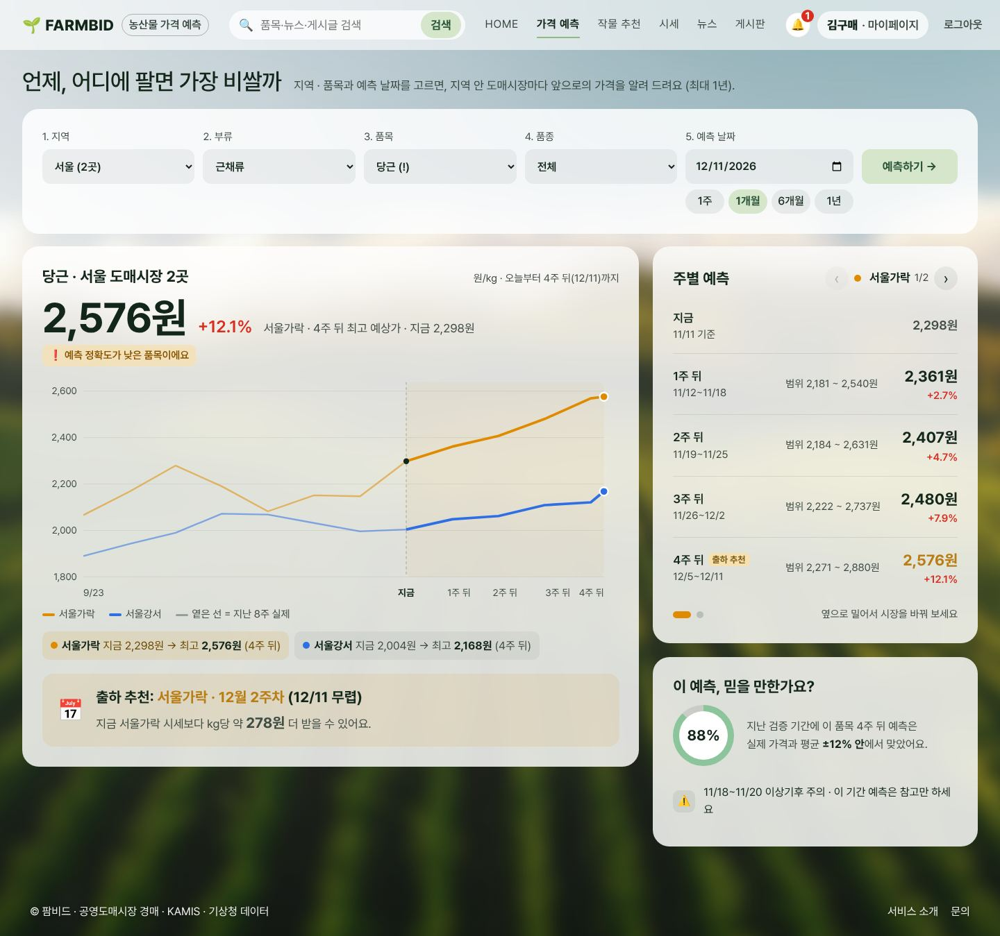

- 계절 패턴 · 월별 반입량은 아직 **예시 데이터**(제목 옆 "예시 데이터", `mocks/seasonal.js`, 지금 시세에 맞춰 크기만 조정). 실제 연결 제안: `GET /api/prices/{item}/monthly` — 경매원장 월별 집계(월평균 = 총 금액 ÷ 총 물량, 반입량 = 총 물량)
- API 1-4 `POST /predict` 를 **지역 안 시장마다 한 번씩** — `market`, `horizon`(오늘 ~ 예측 날짜, 1~365), `history_days: 56`. 품종 가격은 아직 가짜(품목 예측 × 품종 계수)

---

## 3. 작물 추천 `/recommend`

제목 "내 땅에 무엇을 심을까" · `pages/Recommend.jsx`, `pages/recommend.css`

### 3-1. 내 땅으로 고르기 `/recommend`

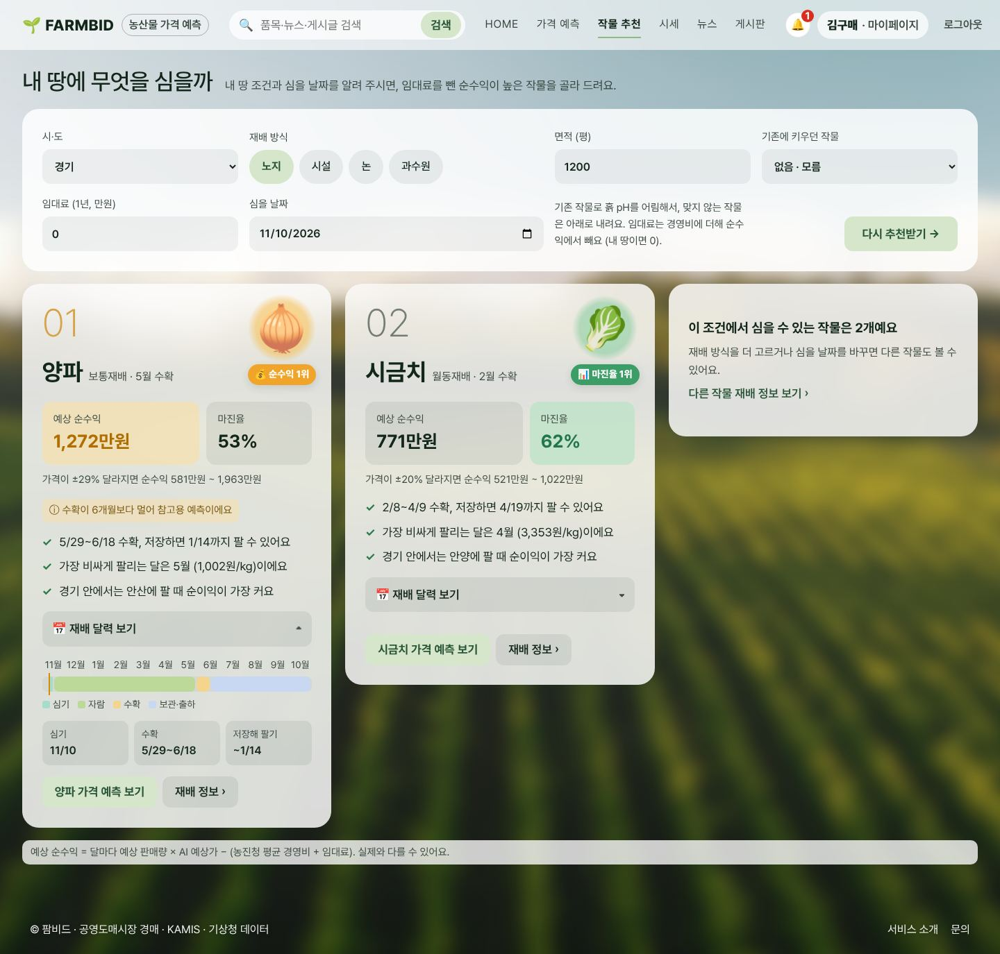

**위 입력 (한 카드)**

| 입력 | 규칙 |
|---|---|
| 시·도 | 17곳. 그 시·도 안 도매시장끼리 비교 (시장이 없으면 전국 평균) |
| 재배 방식 | 노지 · 시설 · 논 · 과수원 (여러 개 고를 수 있음) |
| 면적 (평) · 기존에 키운 작물 ⓘ | 기존 작물로 흙 pH 를 어림해서 맞지 않는 작물은 아래로 (설명은 칸 이름 옆 ⓘ 를 눌러야 보임) |
| 임대료 (1년, 만원) ⓘ | 경영비에 더해 순수익에서 뺌 (내 땅이면 0, 설명은 ⓘ) |
| 심을 날짜 | **오늘 ~ 1년 뒤** |
| [다시 추천받기 →] | 고른 값은 이 탭을 닫기 전까지 기억 |

**결과 TOP3 카드** — 순위(01~03, 굵게) · 작물 그림 · 이름 · 작형 · 수확 달

- **순수익 1위**(주황 "💰 순수익 1위") · **마진율 1위**(초록 "📊 마진율 1위") 카드는 그림 부분을 강조
- 예상 순수익 · 마진율 상자 · 참고용 안내(예측이 덜 정확한 작물·기간만. "수확이 6개월보다 멀어 참고용"은 11-12 뺌). "가격이 ±n% 달라지면" 줄과 계산식 문구는 11-11 뺌
- 추천 이유 문장(수확·저장 기간 · 비싼 달 · 시장)은 카드에서 뺌(11-12) — 작물 정보의 "추천 결과" 카드에서만 보여 줌
- 📅 재배 달력 보기(펼침) · [작물 가격 예측 보기] (50품목만) · [재배 정보 ›]
- 결과가 3개보다 적으면 빈 칸에 "이 조건에서 심을 수 있는 작물은 n개예요" 안내
- API 1-6 `POST /recommend/crops` (`lands[]`, `start_date`)

### 3-2. 작물 정보 `/recommend?tab=info&crop=onion`

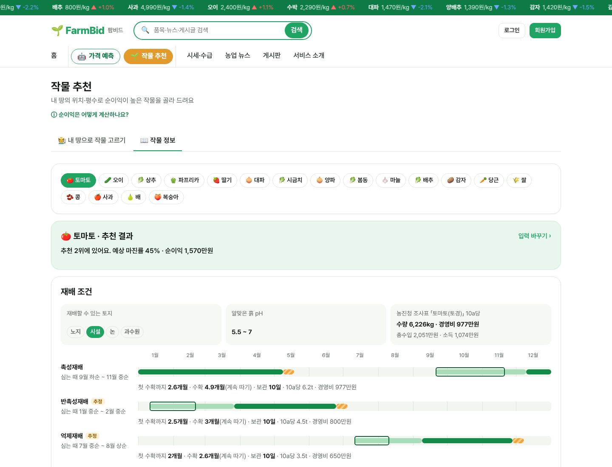

- 작물 고르기: **검색되는 펼침 목록** (재배 방식별로 묶음, 추천 순위 표시) + 추천 작물 칩
- 추천 결과(① 입력 기준 몇 위인지, 빠졌으면 이유) · 재배 조건(재배 방식 · 알맞은 흙 pH 막대 · 농진청 10a당 수량·경영비)
- 재배 달력(작형별, 심기 청록 · 자람 연두 · 수확 호박색 · 보관 하늘색)
- **앞으로 12개월 예상 도매가** (주 단위 53점, 수확 기간 표시)
- API 1-6 `GET /recommend/crops/{code}`, `GET /recommend/price-path`

휴대폰: 카드가 한 줄에 하나. 가격 예측 그래프와 12개월 가격 그래프는 휴대폰용으로 다시 그려 글씨 크기를 지킴(날짜 이름표는 몇 개만). 재배 달력은 작형 이름이 막대 위로 올라감. 시세 표는 줄바꿈 없이 옆으로 밀어 봄(오른쪽 끝이 흐려짐)

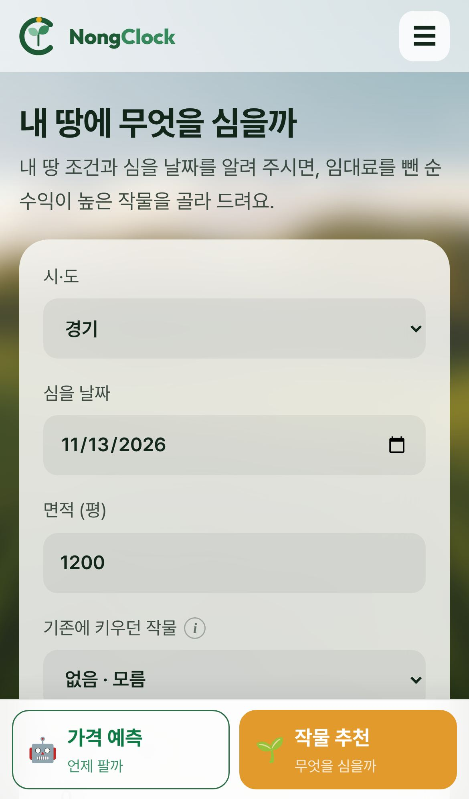 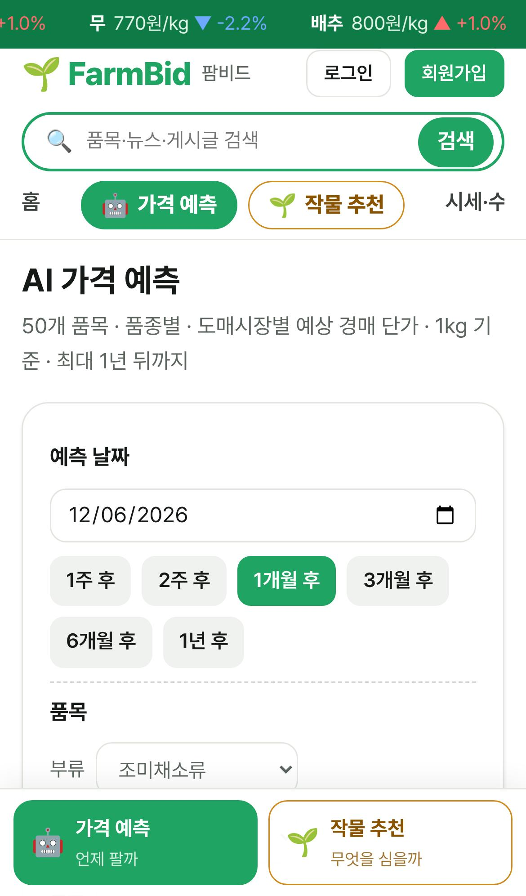

---

## 4. 시세 · 수급 `/market`

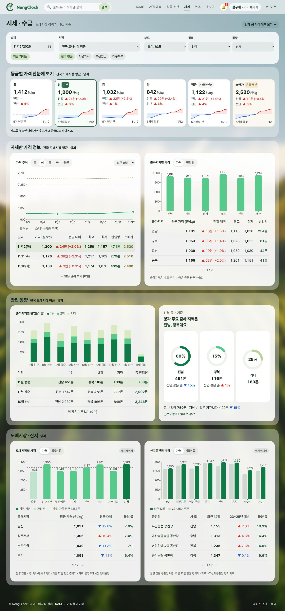

| 구역 | 내용 | API |
|---|---|---|
| 조건 | 한 줄: 날짜(최근 거래일) · 시장(전국 평균 + 32곳, 빠른 버튼) · 부류 · 품목 · 품종 (가격 예측과 같은 부품). 다섯 칸 이름·입력 높이를 맞춤("품목 · 품종" 묶음 이름은 11-12 뺌) | 2-15 |
| 오른쪽 위 | "[품목 품종] AI 가격 예측 보기 →" (같은 품종으로 예측 화면) | |
| 등급별 가격 한눈에 보기 | 특 · 상(기본) · 중 · 하 · 평균 · 소매가 카드: 가격 · 전일 · 전년 · 최근 5거래일 그래프. 카드를 누르면 아래 추이가 그 등급으로 | 2-15 grades |
| 자세한 가격 정보 | 가격 추이(등급 · 기간) · 출하지역별 가격/반입량 | 2-15 history, origins |
| 반입 동향 | 순(10일) 단위 출하지역별 반입량 · 이번 순 요약(왼쪽 카드 높이에 맞춰 고리 칸이 늘어남) · ⓘ 반입량 세는 법 | 2-15 volumes |
| **도매시장 · 산지** (맨 아래, 11-12) | **위에서 고른 시장과 상관없이 품목·품종만, 최근 12달.** 두 카드 모두 [가격 / 물량 몫] 버튼 + 막대그래프 + 표 4줄씩 넘김. ① 도매시장별 가격: 물량 많은 시장 8곳, 가장 비싼 곳 진한 초록 · 가장 싼 곳 연한 초록 · 점선 = 물량 가중 평균, 표 = 평균 가격 · 평균 대비 · 물량 몫 ② 산지공판장 가격: 물량 많은 공판장 8곳, 최근 12달(초록)과 23~25년 평균(회색) 막대 비교, 표 = 시·도 · 최근 12달 · 23~25년 대비 · 물량 몫. 휴대폰은 그래프 4곳 · 표 칸 줄임. **아직 예시 데이터**(제목 옆 "예시 데이터", `mocks/market.js` mockMarketShare · mockAuctionHouses) | 제안: `GET /api/prices/{item}/market-share`, `/auction-houses` (`?variety=`) |

- 구역(등급별 · 자세한 가격 · 반입 동향 · 도매시장 · 산지)마다 옅은 유리판으로 묶고 구역 제목은 그 판 안 왼쪽 위 (제목 뒤 흰 띠 · 글자 효과 없음, 11-12). 나란한 카드는 같은 높이(남는 높이는 그래프가 채움)
- 품종을 고르면 가격은 그 품종, 반입량은 그 품종 물량 비중만큼 (소매가는 품목 단위라 같음)
- 그 시장에서 거래하지 않는 품목이면 안내 + 거래하는 품목 버튼

---

## 5. 농업 뉴스 `/news`

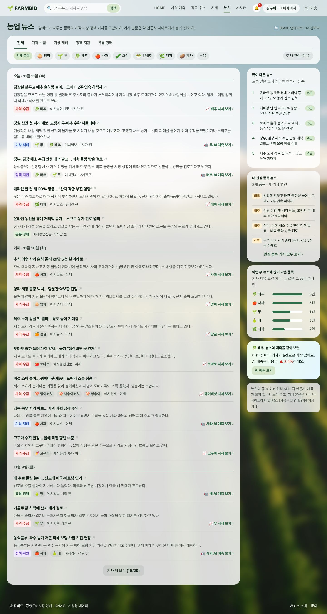

- 왼쪽: 분류 탭(전체 · 가격·수급 · 기상·재해 · 정책·지원 · 유통·경매) · 품목 칩 · ♡ 내 관심 품목만 · 날짜별 기사 목록(언론사 · 시간 · 품목 · 시세/AI 예측 바로가기) · 더 보기
- 오른쪽:
  - **많이 다룬 뉴스** — 오늘 기사 중 같은 소식을 다룬 언론사가 많은 순 5개, "n곳" (`press_count`)
  - **내 관심 품목 뉴스** — 관심 품목 기사 4개 + 모두 보기. 로그인 전이면 "로그인하면 관심 품목 기사만 모아 볼 수 있어요 [로그인하기]", 관심 품목이 없으면 고르러 가기
  - 이번 주 뉴스에 많이 나온 품목 · 뉴스와 예측을 같이 보면 · 뉴스 출처
- 제목을 누르면 언론사 기사로. API 2-14 (서버에서는 1시간마다 수집한 파일)

## 6. 통합 검색 `/search?q=`

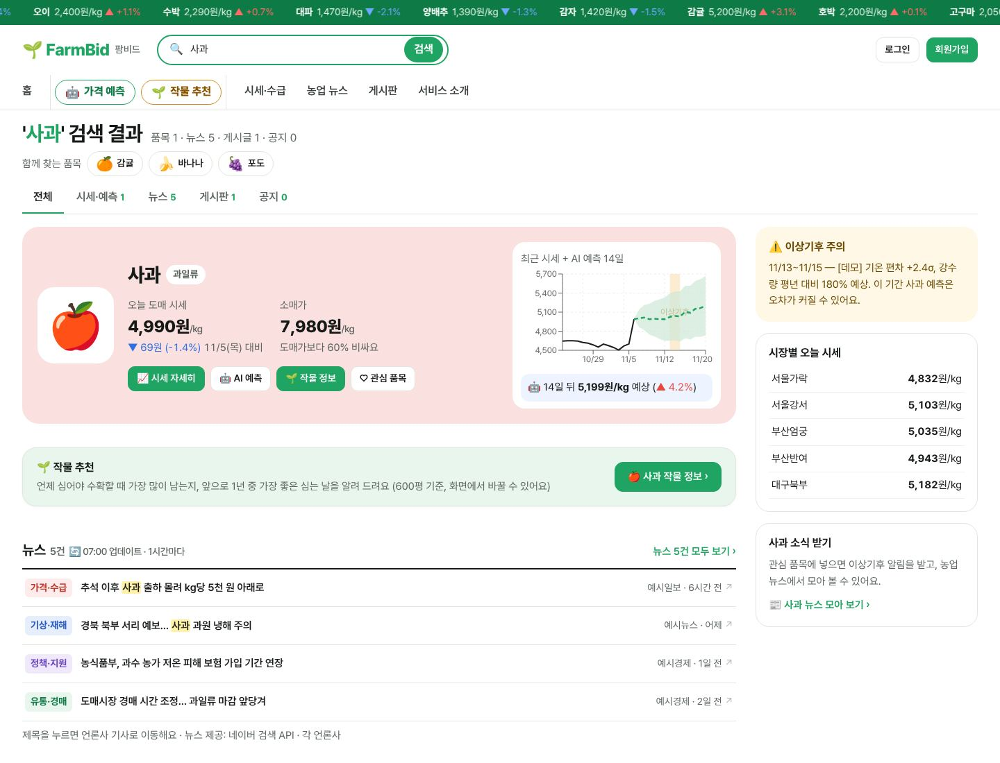

헤더 검색창(자동완성) → **시세** 탭(오늘 도매 시세 · 소매가 · **최근 8거래일 도매 시세 그래프** · 시장별 오늘 시세) · 뉴스 · 게시판 · 공지 탭. AI 예측은 바로가기 버튼만. 검색 결과는 흰 판 위에 보여 줌. API 2-13

## 7. 게시판 `/board`

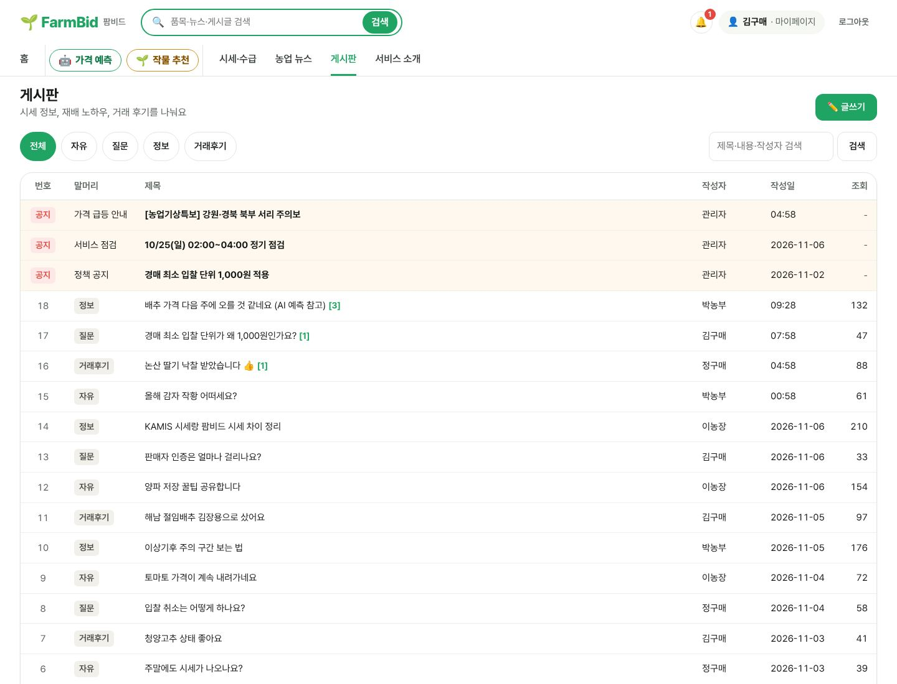

- 목록: 공지(위 고정) · 말머리(자유 · 질문 · 정보 · 거래후기) · 검색 · 15개씩 · 사진·댓글 수 표시 · 글쓰기(로그인)
- 글: 본문 · 사진 · 댓글/답글 · 수정/삭제(작성자). **신고 없음**(11-11). 로그인 전에는 댓글 칸을 누르면 로그인 화면으로
- 글쓰기: 말머리 · 제목 · 내용 · 사진(최대 개수 제한)

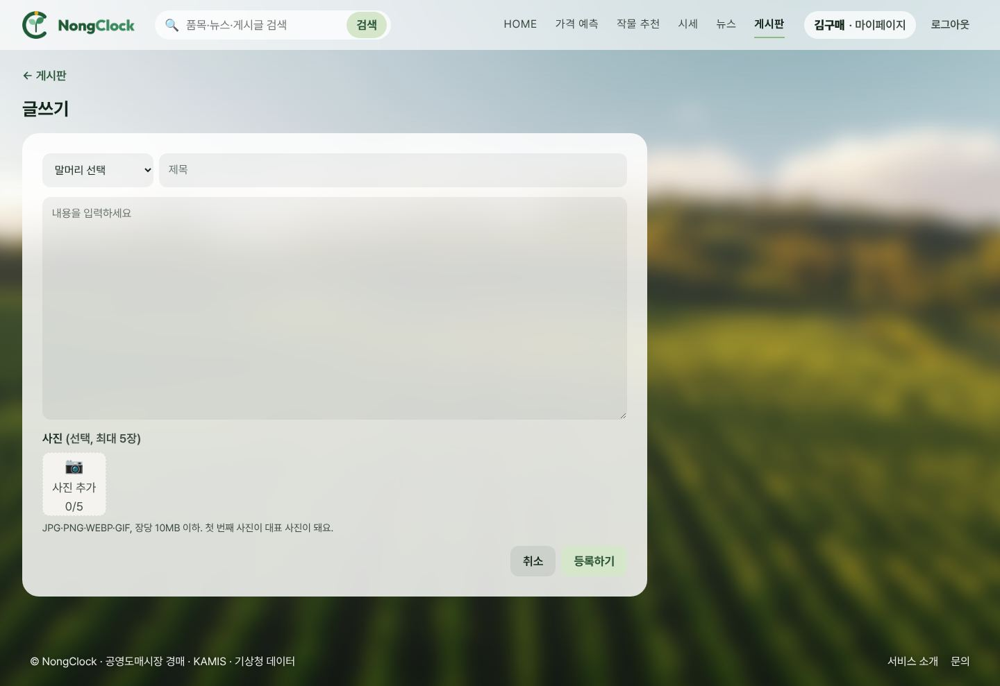

API 2-8 ~ 2-11

## 8. 서비스 소개 `/about`

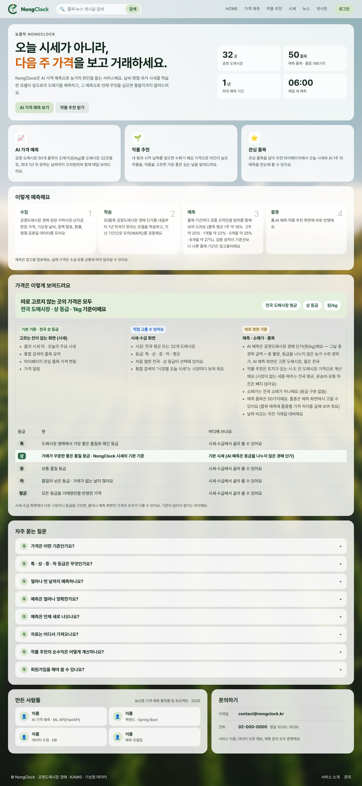

`pages/About.jsx`, `pages/about.css`

- 머리 카드: "오늘 시세가 아니라, **다음 주 가격**을 보고 거래하세요." · [AI 가격 예측 보기] [작물 추천 받기] · 숫자 4칸(공영 도매시장 32곳 · 50품목/품종 수 · 최대 예측 기간 · 매일 06:00 새 예측). 숫자는 `items50.json`·도매시장 목록에서 셈
- 기능 4칸 · 이렇게 예측해요(수집 1 · 학습 2 · 예측 3 · 활용 4) · 가격은 이렇게 보여드려요(기준 · 등급 표) · 만든 사람들 · 문의하기
- 다른 화면이 거는 자리: `#items` `#how` `#price` `#price-basis` `#grades` `#team` `#contact`

## 9. 로그인 · 회원가입

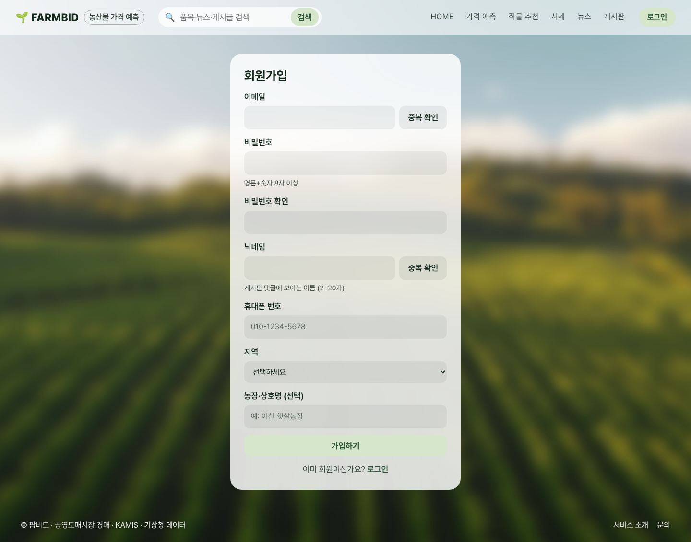 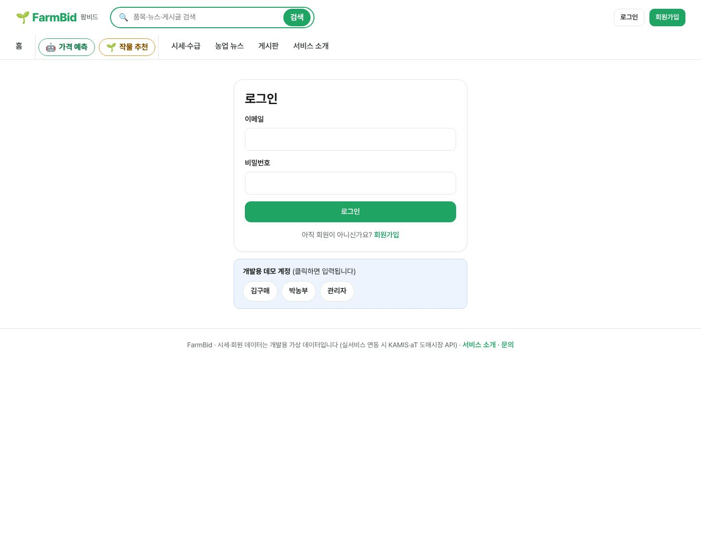

- 회원가입: **약관 동의 단계 없이 바로 정보 입력** (마케팅 수신 동의 칸 없음 — 가입 요청에 `marketing` 을 보내지 않음) — 이메일 **[중복 확인]** · 비밀번호 · 비밀번호 확인 · **닉네임**(2~20자) **[중복 확인]** · 휴대폰 · 지역 · 농장명(선택). 두 중복 확인을 통과해야 가입 (값을 바꾸면 다시 확인)
- 가격 예측·작물 추천·게시판 글쓰기·댓글은 로그인한 회원만
- 로그인: 이메일 · 비밀번호 (개발용 데모 계정 버튼)
- API 2-3, 회원 백엔드(Spring) `/api/auth/*`

## 10. 마이페이지 `/mypage` (로그인)

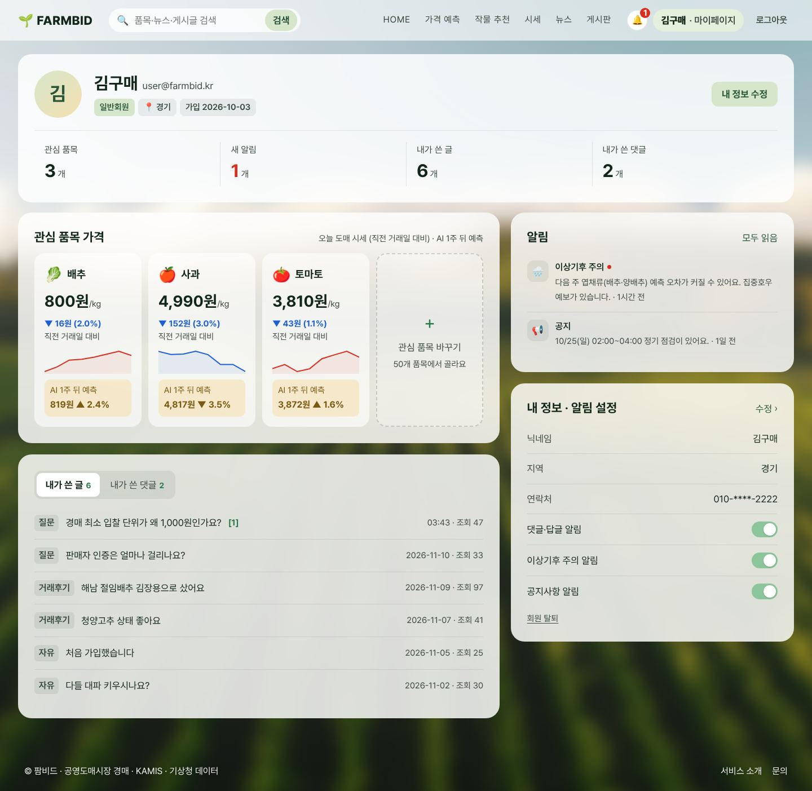

`pages/mypage/MyPage.jsx`, `pages/mypage/mypage.css`

- 위: 내 정보(닉네임 · 이메일 · 회원 구분 · 지역 · 가입일) · [내 정보 수정] · 숫자 4칸(관심 품목 · 새 알림 · 내가 쓴 글 · 내가 쓴 댓글)
- 왼쪽: **관심 품목 가격** 카드(오늘 도매가 · 직전 거래일 대비 · 8거래일 흐름 · AI 1주 뒤 예측, 최대 3개 + 바꾸기) · **내가 쓴 글 / 댓글** 탭
- 오른쪽: 알림(모두 읽음) · 내 정보·알림 설정(알림 종류별 켜기/끄기)
- "내 정보 수정"·"관심 품목 더하기"는 같은 화면 안에서 편집 화면으로 (`?tab=profile`, `?tab=watch`)
- 신고 내역 탭은 없음 (신고 기능 삭제)
- 아직 Spring 에 없는 것(관심 품목 · 알림 · 내 글/댓글 · 정보 수정)은 가짜 데이터, 서버 모드에서 내 글/댓글은 "서버 준비 중" — API 제안 2-9
- API 2장 `/api/me`, 2-4, 2-9

## 11. 관리자 `/admin/` (관리자 계정)

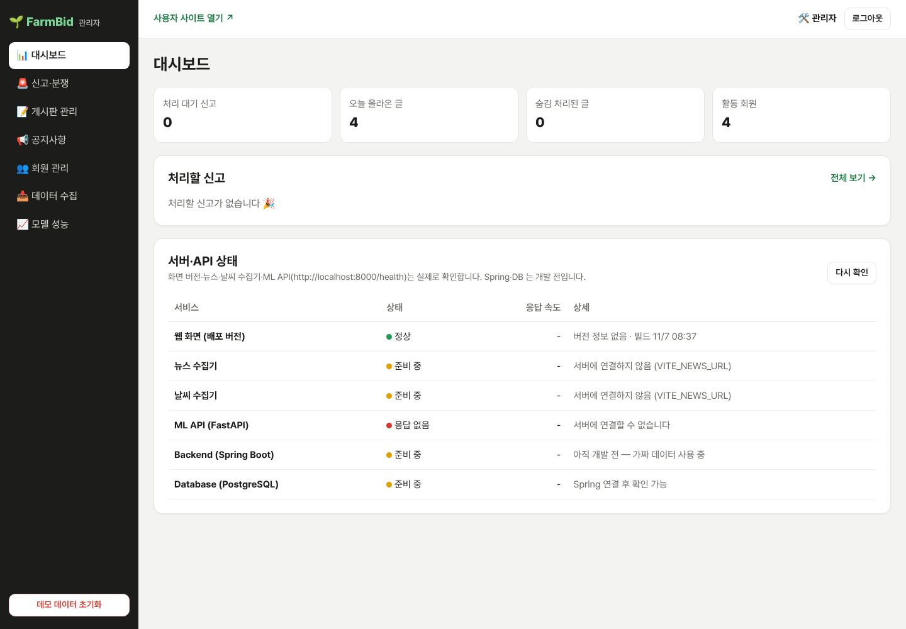

| 메뉴 | 내용 |
|---|---|
| 📊 대시보드 | 처리 대기 신고 · 오늘 글 · 숨김 글 · 활동 회원 · 처리할 신고 · 서버·API 상태 |
| 🚨 신고·분쟁 | 신고 처리 · 이용 제한 (사용자 화면의 신고 기능은 11-11 삭제. 관리자 메뉴는 이번에 손대지 않음 — 정리 여부 팀 결정) |
| 📝 게시판 관리 | 글 숨김·삭제 · 댓글 삭제 |
| 📢 공지사항 | 공지 등록 · 홈 배너 띄우기 |
| 👥 회원 관리 | 회원 목록 · 상태 |
| 📥 데이터 수집 | 뉴스·날씨 수집 기록 · 거른 기사 |
| 📈 모델 성능 | 기간별 평균 오차(WAPE) KPI · 품목별 오차 표 · 참고용 표시 |

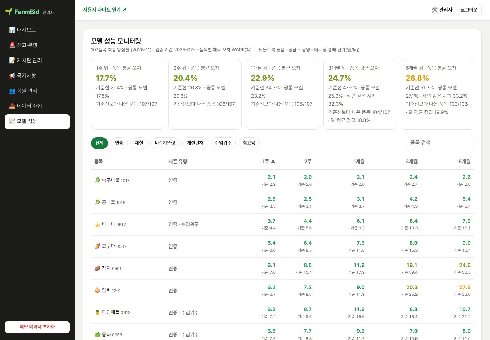

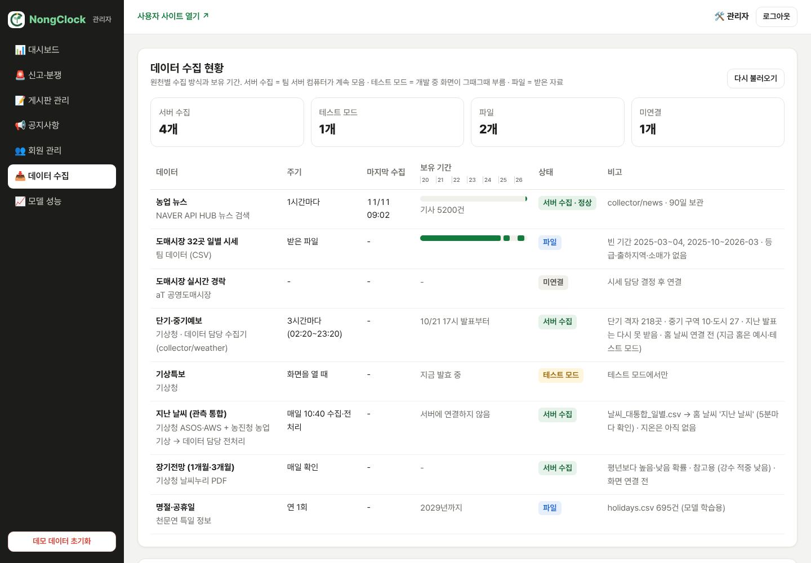

---

## 변경 이력

| 날짜 | 내용 | 작성자 |
|---|---|---|
| 2026-11-06 | 최초 작성 — 지금 화면 기준(50품목 · 품종, 대시보드 주식 앱 형태, 가격 예측 검색 조건, 작물 추천 품종 묶기, 시세 품종, 설명 글씨 정리 반영). 화면 캡처 `docs/ui/` | |
| 2026-11-06 | 강사님 피드백 반영 — 위·양옆 여백 축소(본문 폭 1600px), 페이지 제목 한 줄, 가격 예측 검색 두 줄·최근 검색 삭제, 홈 두 카드 강조·움직임·💰 가장 비싼 날 상자. 캡처 교체 | |
| 2026-11-06 | 홈 가격 예측 카드: 품목을 3개월 뒤 가장 크게 오를 품목으로, 작은 그래프를 3개월로 (가장 비싼 날 점이 선에서 벗어나던 문제 수정) | |
| 2026-11-06 | 홈 두 카드가 5초마다 바뀜 — 가격 예측: 1주·1개월·3개월 × 오를·내릴 품목 6가지(가장 싼 날 파란 상자 추가), 작물 추천: 노지·시설·논·과수원(논은 다음 심는 때, 과수원은 수확철 예상 도매가). 부드럽게 바뀌는 효과 | |
| 2026-11-07 | 시세 띠 삭제, 회원가입 약관 단계 삭제·닉네임·이메일/닉네임 중복 확인, 가격 예측·작물 추천 회원 전용, 검색 "시세" 탭(최근 8거래일 그래프), 가격 예측 도매시장 먼저(전국 평균 추가, 시장에서 거래 안 하는 품목 빠짐) | |
| 2026-11-11 | **새 디자인(v17)** — 들판 사진 + 흰 유리 카드, 새 헤더·로그인 버튼 하나, 회원 화면은 로그인 후 돌아옴, 글씨 크게(최소 15px)·회색 진하게. 홈: 사진 첫 화면 + 흰 바탕이 덮는 오늘의 농업 정보(뉴스·날씨 나란히) + 서비스 소개. 가격 예측: 기준 날짜(1년 전까지)·4주 주별 예측·작년 같은 시기 선·출하 추천 시기. 작물 추천: 한 카드 입력·심을 날짜 1년·TOP3 카드(순수익/마진율 1위 강조)·작물 정보 검색 목록·12개월 가격. 뉴스: 많이 다룬 뉴스·내 관심 품목 뉴스. 마이페이지·서비스 소개 새 배치. 신고 기능 삭제, 마케팅 동의 없음. 캡처 교체 | |
| 2026-11-11 | 시세 조건 칸 · 반입 동향 요약 · 뉴스 분류·품목 칸이 사진 위에 투명하게 떠 보이던 것 수정 (흰 유리 판). 캡처 `04_market` · `05_news` 교체 | |
| 2026-11-11 | 뉴스 제목 옆 설명이 혼자 흰 배경을 달고 제목 아래로 내려가던 것 → 다른 화면처럼 제목 옆 한 줄로. 캡처 `05_news` 교체 | |
| 2026-11-11 | **휴대폰 맞춤** — ☰ 메뉴(검색·모든 메뉴·마이페이지), 홈 미리보기 카드 잘림·지역 날씨·서비스 소개 칸, 가격 예측·12개월 가격 그래프 휴대폰용, 작물 카드 이름 겹침·재배 달력, 시세 등급 카드·표, 마이페이지 가로 넘침, 바닥글 진한 띠. 캡처 `12_m_*` 교체 | |
| 2026-11-11 | 품종 목록을 팀 기준(화면묶음·예측단위)으로 다시 짬 — 품종 196개, 순서는 표 순서, 기타 하나뿐인 품목은 "전체"만, 옛 품종 주소는 "전체"로 | |
| 2026-11-11 | **가격 예측: 지역별 · 최대 1년** — 도매시장 대신 시·도를 고르고 지역 안 시장마다 선, 시장별 예측 카드 넘기기(2개월까지 주별 · 그 뒤 달별), 예측 날짜 내일 ~ 1년 뒤 + 1주·1개월·6개월·1년 버튼, 지난 기준 날짜·작년 같은 시기 선·많이 찾는 품목 칩 뺌. 캡처 `02_predict` · `02b_predict_lowacc` · `12_m_predict` 교체 | |
| 2026-11-11 | 안쪽 스크롤바(가격 예측 시장별 목록 · 작물 고르기 목록 · 재배 달력 · 표 · 검색 자동완성 · 휴대폰 메뉴)를 회색 기본 막대 대신 얇고 옅은 둥근 막대로 (위아래 화살표 없음) | |
| 2026-11-11 | 로고 옆 "농산물 가격 예측" 글자 뺌 · 모든 화면 제목 굵게. 작물 추천: 흙 pH·임대료 설명을 칸 이름 옆 ⓘ 말풍선으로, 순위 숫자 굵게, "가격이 ±n% 달라지면" 줄·계산식 문구 뺌. **홈 날씨 카드를 서버 날씨 수집기 관측(어제 기준)에 연결** (안 쓰던 `WeatherMap` · `RecentWeather` 삭제). 캡처 `01`~`10`, `12_m_*` 교체 | |
| 2026-11-11 | **사이트 이름 NongClock 으로 통일** — 헤더 로고를 팀 시안 20번(C 링 새싹) 이미지로, 브라우저 탭 아이콘 추가, 탭 제목·바닥글·서비스 소개·뉴스·검색 문구·관리자 로고의 "팜비드/FarmBid" → NongClock, 문의 메일 예시 contact@nongclock.kr. 캡처 모두 교체 | |
| 2026-11-12 | 가격 예측: 아래에 **계절 패턴 · 월별 반입량** 카드(예시 데이터), 그래프 카드 아래 빈 공간 없앰(오른쪽 열 높이에 맞춰 그래프가 늘어남), "6개월보다 먼 예측이라 참고용" 안내 뺌. 작물 추천: 카드의 추천 이유 3줄 · "수확이 멀어 참고용" 안내 뺌. 캡처 `02_predict` · `02b_predict_lowacc` · `03_recommend` · `12_m_predict` · `12_m_recommend` 교체 | |
| 2026-11-12 | 시세: 맨 아래 **도매시장 · 산지** 구역(도매시장별 가격 · 산지공판장 가격, 고른 시장과 상관없이 품목·품종만, 예시 데이터). 구역마다 옅은 유리판으로 묶고 제목 뒤 흰 띠 없앰, "순(10일) 단위" 문구 뺌. 가격 추이 · 반입 동향 요약 칸 높이를 옆 카드에 맞춤. 캡처 `04_market` 교체 | |
| 2026-11-12 | 시세 조건: "품목 · 품종" 묶음 이름을 빼고 부류 · 품목 · 품종 칸을 날짜 · 시장과 같은 높이로. 캡처 `04_market` 교체 | |
